# 🩺 CureBuddy – Online Doctor Appointment System

CureBuddy is a full-stack web application that connects patients with doctors and makes booking appointments online simple. It has separate experiences for patients, doctors and admins, and admins approve or reject doctor registrations before doctors can go live.

**🌐 Live demo:** https://cure-buddy.vercel.app

> ⏳ **Note:** The backend is hosted on Render's free tier and goes to sleep when idle. The first request after a while can take 30–60 seconds. Please wait a moment after opening the site.

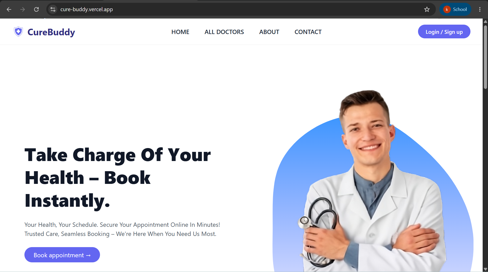

---

## ✨ Features

### 👤 Patient
- Register and log in
- Browse the list of available doctors
- Book an appointment with a doctor
- View appointment history

### 🩺 Doctor
- Register as a doctor (account is reviewed by an admin)
- Doctor dashboard to manage appointments

### 🛡️ Admin
- Admin dashboard overview
- View all registered doctors
- Review doctor details and approve or reject registrations

---

## 🚀 Tech Stack

| Layer | Technologies |
|---|---|
| Frontend | React, TypeScript, Vite, Tailwind CSS, React Router DOM, Axios |
| Backend | Node.js, Express |
| Database | MongoDB Atlas, Mongoose |
| Auth & Uploads | JSON Web Tokens (JWT), Multer |
| Hosting | Vercel (frontend), Render (backend) |

---

## 📸 Screenshots

### Home & Authentication
| Home | Login |
|---|---|
|  | 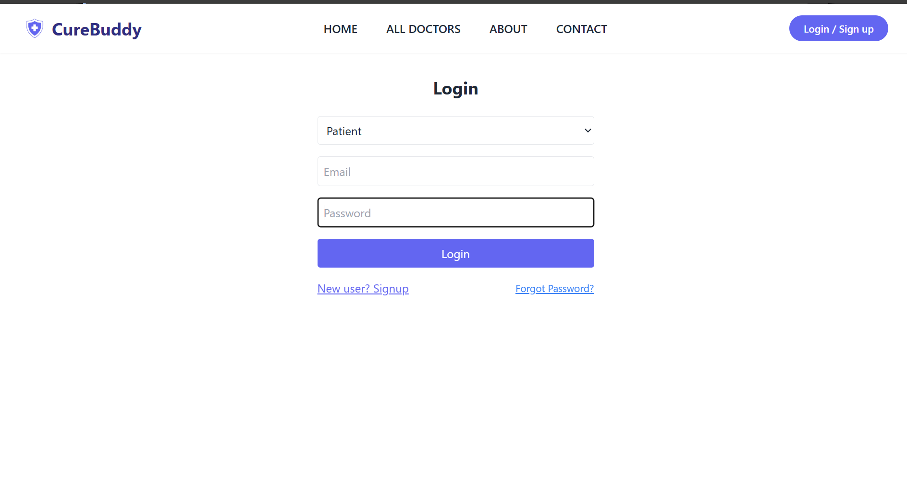 |

| Patient Registration | Doctor Registration |
|---|---|
| 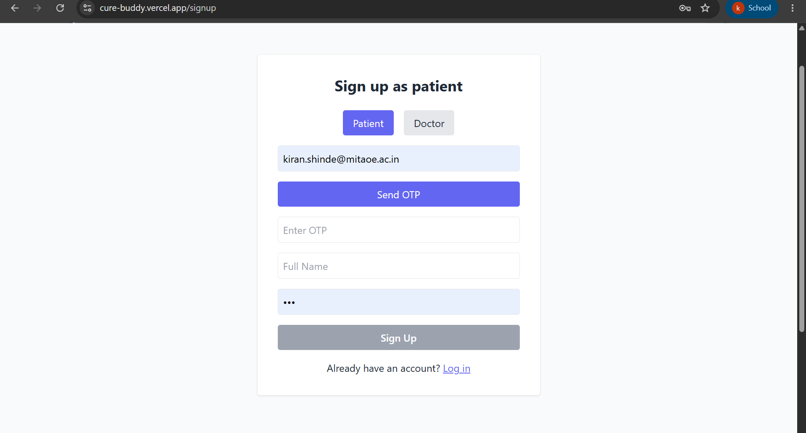 | 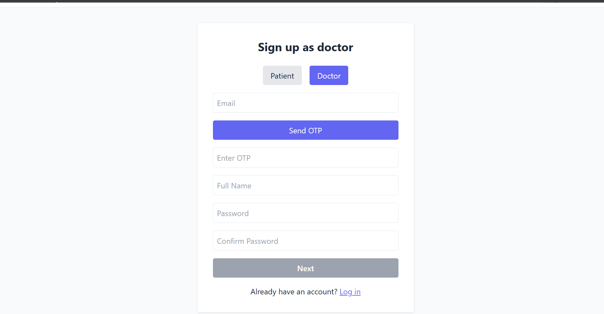 |

### Patient
| Doctor List | Appointment Booking |
|---|---|
| 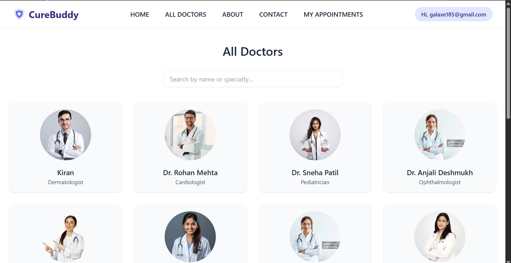 | 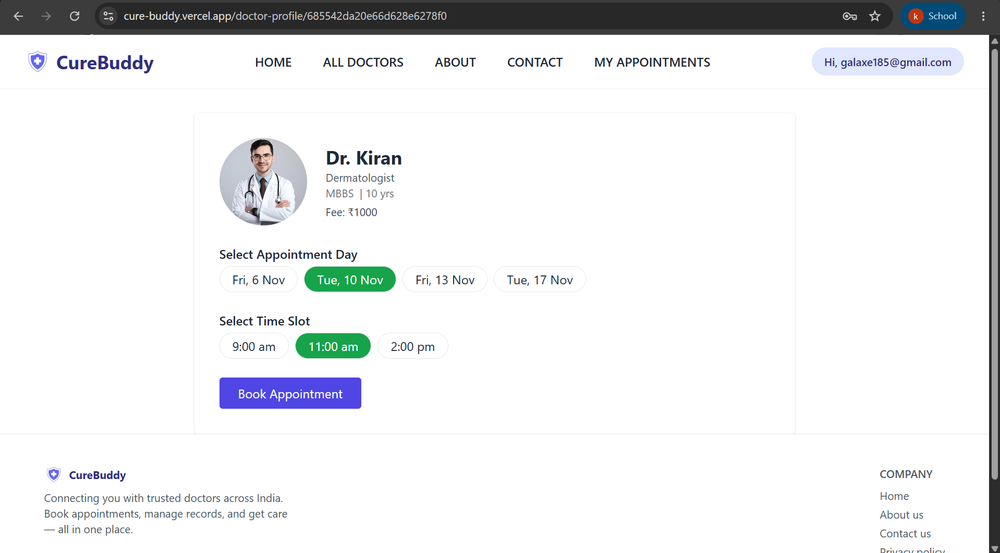 |

| Appointment History |
|---|
| 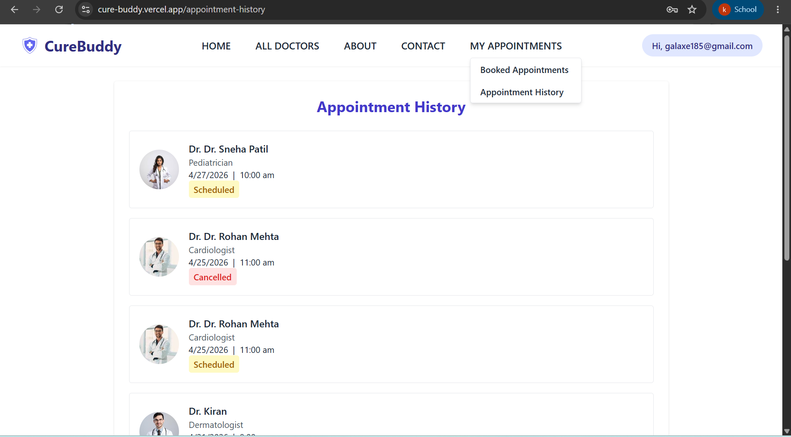 |

### Doctor
| Doctor Dashboard |
|---|
| 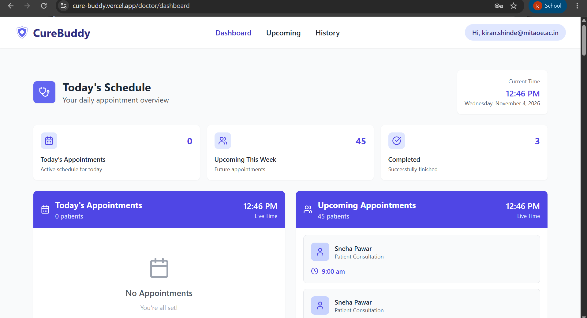 |

### Admin
| Admin Dashboard | All Doctors |
|---|---|
| 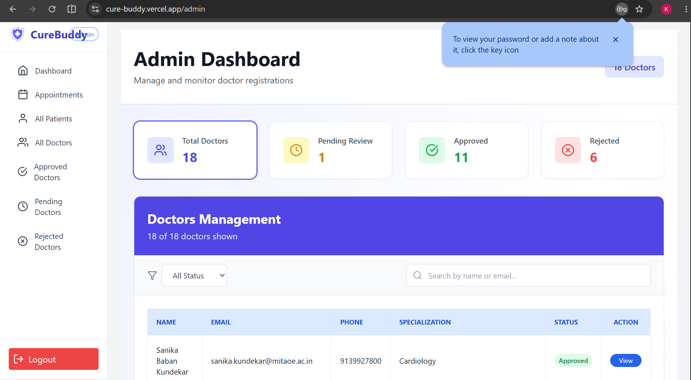 | 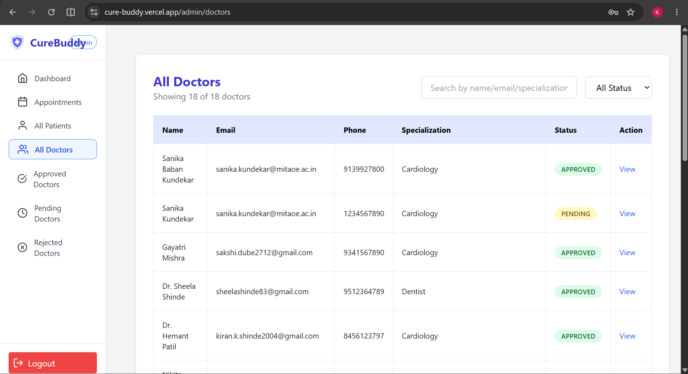 |

| Doctor Details (Approve / Reject) |
|---|
| 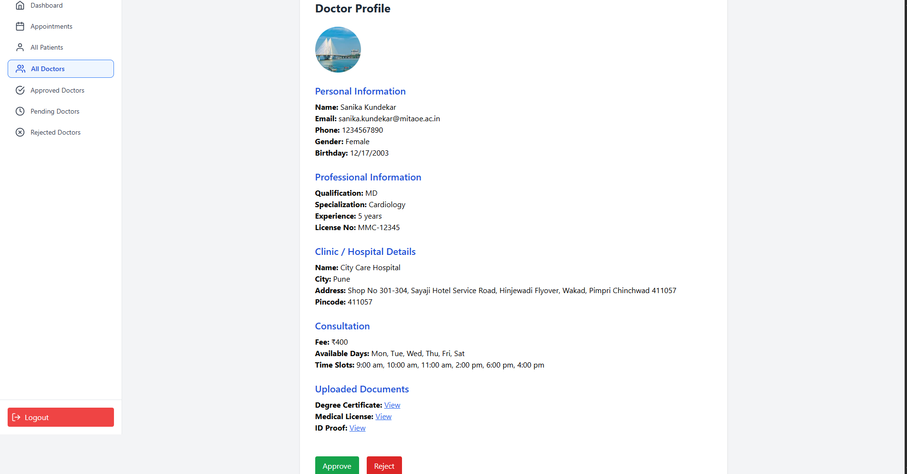 |

---

## 🔌 API Endpoints

Base URL (production): `https://curebuddy-1-zgdm.onrender.com`

Protected routes require the header `Authorization: Bearer <token>`.

| Method | Endpoint | Description | Auth |
|---|---|---|---|
| POST | `/api/auth/signup` | Register a user | No |
| POST | `/api/auth/login` | User login and JWT generation | No |
| POST | `/api/auth/send-otp` | Send registration OTP | No |
| POST | `/api/auth/verify-otp` | Verify registration OTP | No |
| GET | `/api/doctors/approved` | Get approved doctors | No |
| POST | `/api/doctors/register` | Register as a doctor | No |
| GET | `/api/doctors/me` | Get logged-in doctor's profile | Yes (Doctor) |
| POST | `/api/appointments/book` | Book an appointment | Yes (Patient) |
| GET | `/api/appointments/patient/:patientId` | Get patient appointment history | Yes |
| PUT | `/api/appointments/:id/cancel-by-patient` | Cancel appointment as patient | Yes (Patient) |
| PUT | `/api/appointments/:id/cancel-by-doctor` | Cancel appointment as doctor | Yes (Doctor) |
| GET | `/api/appointments/doctor/me` | Get doctor's appointments | Yes (Doctor) |
| GET | `/api/appointments/doctor/summary` | Get doctor dashboard summary | Yes (Doctor) |
| PATCH | `/api/doctors/:id/approve` | Approve doctor registration | Yes (Admin) |
| PATCH | `/api/doctors/:id/reject` | Reject doctor registration | Yes (Admin) |
| GET | `/api/admin/doctors` | Get all doctors | Yes (Admin) |
| GET | `/api/admin/patients` | Get all patients | Yes (Admin) |
| GET | `/api/admin/appointments` | Get all appointments | Yes (Admin) |
| DELETE | `/api/admin/patients/:id` | Delete a patient | Yes (Admin) |

**Note:** The API also includes password-reset endpoints. Doctor registration and other routes may have additional validation requirements.

---

## ⚙️ Local Development Setup

### Prerequisites
- Node.js 18+
- A MongoDB connection string (MongoDB Atlas or a local MongoDB)

### 1. Clone the repository
```bash
git clone https://github.com/kiranshinde24/CureBuddy.git
cd CureBuddy
```

### 2. Backend setup
```bash
cd Backend
npm install
```

Create a `.env` file inside the `Backend/` folder:
```env
PORT=5000
MONGO_URI=your_mongodb_connection_string
JWT_SECRET=your_secret_key
```

Start the backend:
```bash
npm start
```
The server runs at http://localhost:5000

### 3. Frontend setup
Open a new terminal:
```bash
cd frontend
npm install
```

Create a `.env` file inside the `frontend/` folder:
```env
VITE_API_URL=http://localhost:5000
```

Start the frontend:
```bash
npm run dev
```
The app runs at http://localhost:5173

---

## 📁 Project Structure

```
CureBuddy/
├── Backend/         # Express API, models, routes
├── frontend/        # React + TypeScript app (Vite)
├── docs/            # Project charter, Gantt/RACI charts, test cases, DB design
├── screenshots/     # README screenshots
└── README.md
```

## 📚 Project Documents

The project charter, Gantt and RACI charts, test cases and MongoDB collection design are in the [`docs/`](docs/) folder.

---

## 👨‍💻 Author

**Kiran Shinde**
GitHub: [@kiranshinde24](https://github.com/kiranshinde24)
